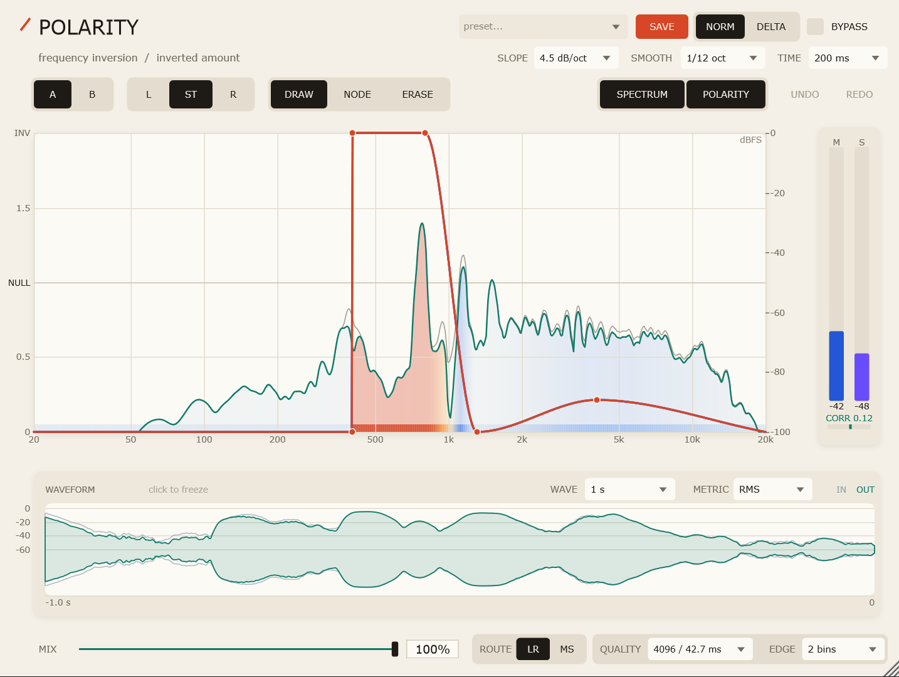

# Polarity

[](https://github.com/Nejiwwkr/polarity/actions/workflows/build.yml)

**Draw the frequencies you want to remove — or flip upside down.**

Polarity is a VST3 / standalone effect for Windows that turns polarity inversion into a drawable EQ curve. Instead of boosting or cutting gain, every point on the curve sets how much **inverted signal** is mixed into that frequency band:

- `0` — untouched
- `1` — complete null (the band disappears)
- `2` — full polarity inversion

Draw separate curves for the left and right channels, or link them together with **ST**. A zero-phase FIR engine applies the curve, so the nulls are real nulls instead of the phasey cancellation of a minimum-phase EQ.



## Highlights

- **L / ST / R curve editing** with draw, node and erase tools.
- **Zero-phase FIR processing** with host PDC; what you draw is what you hear.
- **Four quality tiers** — 1024 / 2048 / 4096 / 8192 taps — trading latency for frequency resolution and null depth.
- **L/R and M/S routing** — draw the curves in stereo or in mid/side, so you can do things like make the low end mono or remove centred content with a true zero.
- **A/B curve slots** for fast comparisons, plus file presets.
- **NORM / DELTA monitoring** — DELTA plays exactly what the curves removed, so you can hear the inverted content in isolation.
- **Spectrum and inversion heatmap** overlaid on the curve, with adjustable slope, smoothing and release time.
- **Input/output waveform** with RMS or Peak envelope, adjustable window and click-to-freeze.
- **Mid/Side level and correlation meters** for mono-compatibility checks.
- **Host integration** — Mix, Bypass, Delta Out, A/B Slot, Quality and Edge Smoothing are real VST3 parameters with value text and edit gestures; FL Studio can automate and undo them.
- **Light paper/ink interface** with themed hover tooltips.
- **44.1 / 48 / 96 / 192 kHz**, mono and stereo, buffer sizes down to 32 samples.

## Download & install

The latest release is **v1.1.0**.

### Installer (recommended)

1. Download `Polarity-<version>-win64-setup.exe` from the [Releases page](https://github.com/Nejiwwkr/polarity/releases).
2. Run it. The default install is per-user and does not require administrator rights; choose **Install for all users** in the wizard if your host only scans the shared VST3 folder.
3. Rescan plugins in your DAW. In FL Studio: **Options → Manage plugins → Find installed plugins**.

Install locations:

| | Per-user (default) | All users |
|---|---|---|
| VST3 | `%APPDATA%\VST3\Polarity.vst3` | `C:\Program Files\Common Files\VST3\Polarity.vst3` |
| Standalone | `%LOCALAPPDATA%\Programs\Polarity` | `C:\Program Files\Polarity` |

The installer is not code-signed, so Windows SmartScreen may show an unknown-publisher warning. Do not keep both a per-user and an all-users copy installed.

### Portable zip

1. Download `Polarity-<version>-win64.zip` and extract it anywhere.
2. In PowerShell, from the extracted folder:

   ```powershell
   powershell -ExecutionPolicy Bypass -File .\install_vst3.ps1
   ```

   This installs to `%APPDATA%\VST3`; use `-System` for `C:\Program Files\Common Files\VST3`.

3. Rescan plugins in your DAW.

## Quick start

1. Insert Polarity on a track and open the editor.
2. Choose **L**, **ST** or **R**, then pick **DRAW** or **NODE**.
3. Draw the inversion amount:
   - drag up to `1` for a deep null;
   - drag up to `2` for a full polarity flip;
   - leave at `0` to keep the band untouched.
4. Switch to **DELTA** to hear only the removed/inverted part.
5. Use **A/B** to compare curves, **LR / MS** to choose stereo or mid/side processing, and **QUALITY** to choose between latency and precision.
6. Save the result as a preset with **SAVE**, or let it travel with your project.

## What makes it different

A normal EQ cut is a minimum-phase filter: subtract it from the dry signal and you get comb filtering, not silence. Polarity implements a real-valued, zero-phase magnitude curve:

```text
Y(f) = (1 − A(f)) · X(f)        A(f) ∈ [0, 2]
```

At `A = 1` the band is actually cancelled. At `A = 2` it is polarity-inverted. At `A = 0` the signal passes through untouched. The FIR kernel is designed in the frequency domain and reported to the host as latency, so tracks stay aligned.

## Compatibility

| | |
|---|---|
| Platform | Windows 10 / 11, x64 |
| Formats | VST3, Standalone |
| Tested host | FL Studio (primary), pluginval 1.0.4 strictness 10 |
| Sample rates | 44.1 / 48 / 96 / 192 kHz |
| Buffer sizes | 32 – 2048 samples covered by tests |
| Channels | Mono and stereo |

Latency at 48 kHz:

| Quality | Taps | Latency at 48 kHz |
|---|---|---|
| Fast | 1024 | 10.7 ms |
| Low | 2048 | 21.3 ms |
| Normal | 4096 | 42.7 ms |
| High | 8192 | 85.3 ms |

The engine uses zero-additional-latency partitioned FFT convolution, so the reported latency is still exactly taps / 2. In the offline benchmark, 8192 taps runs at roughly 70× realtime and 4096 taps at roughly 100× realtime with the editor closed (order-of-magnitude lower CPU than the direct convolution used in 1.0.x); with the analysers open, expect a few percent of one core.

## Build from source

Requirements: CMake 3.22+, Visual Studio 2022 with the C++ workload, and JUCE 8.0.15 in `ThirdParty/JUCE-8.0.15/JUCE` (vendored locally or cloned at tag `8.0.15`). Optional: Inno Setup 6 to build the Windows installer.

```bash
cmake -S . -B Build -G "Visual Studio 17 2022" -A x64
cmake --build Build --config Release --target Polarity_VST3 Polarity_Standalone PolarityTests --parallel
```

Run the test suite:

```powershell
.\Build\PolarityTests_artefacts\Release\PolarityTests.exe
```

Package a release zip and, when Inno Setup 6 is installed, the Windows installer:

```powershell
powershell -ExecutionPolicy Bypass -File Tools\package_release.ps1
```

The outputs are written to `dist/`: `Polarity-<version>-win64.zip` and `Polarity-<version>-win64-setup.exe`. Use `-SkipInstaller` when Inno Setup is unavailable.

Run pluginval (downloads v1.0.4 on first use):

```powershell
powershell -ExecutionPolicy Bypass -File Tools\run_pluginval.ps1
```

## Validation

- DSP self-test and processor integration tests pass at 44.1 / 48 / 96 / 192 kHz, block sizes 32 / 512 / 2048, mono and stereo.
- The partitioned FFT engine is checked against the direct convolution reference at 1024 / 2048 / 4096 / 8192 taps across changing block sizes; the maximum difference is about 3e-7.
- Null depth at 1 kHz: about −125 dB (44.1 kHz), −111 dB (48 kHz), −100 dB (96 kHz), −108 dB (192 kHz) on the test curve.
- M/S routing is verified for identity against L/R (identical curves), mono-bass cancellation, click-free switching, and mono operation.
- pluginval 1.0.4, strictness 10, GUI tests enabled: **SUCCESS**.
- State schema v2 with migration from older projects and presets.
- GitHub Actions builds, runs the tests and pluginval, and packages the zip + installer on every push; tags produce a draft release.

## Known limitations

- Changing **QUALITY** changes the reported latency; the host may re-sync playback.
- Switching **LR / MS** produces a short (~60 ms) level dip while the engine re-primes its history. Routing is a structural setting and is not host-automatable.
- Free-drawn curves and display settings are not host-automatable, so they do not appear in the host automation list or hint panel.
- Curve editing uses the plugin's own undo/redo, not the host undo history.
- Windows x64 only. The plug-in and installer are unsigned, so SmartScreen may warn.

## Documentation

- [Chinese technical documentation](Docs/README-zh.md) — design, implementation, build, tests and release details.
- [Changelog](CHANGELOG.md)
- [Releases](https://github.com/Nejiwwkr/polarity/releases)

## License

Polarity is released under the [GNU General Public License v3.0](LICENSE).
